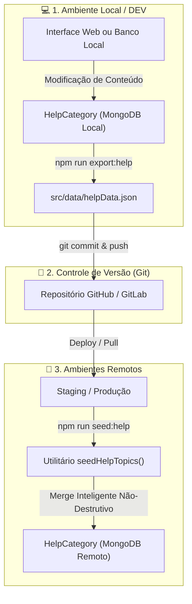

# 📚 Central de Ajuda: Fluxo de Exportação, Versionamento e Sincronização Não-Destrutiva

> **Status:** 🟢 Ativo & Homologado  
> **Escopo:** `bravoback` (Node.js / Express / Mongoose) & `bravofront` (Angular 18+ / Ionic 7+)  
> **Ambientes Suportados:** `Development` (Local) ➔ `Staging` (Homologação) ➔ `Production` (Produção)  
> **Data de Atualização:** 03/09/2026

---

## 🎯 1. Objetivo & Visão Geral

Permitir que a equipe de desenvolvimento e gestão crie e ajuste categorias e tópicos da **Central de Ajuda** no ambiente local ou via painel administrativo, **exporte** as alterações para arquivos versionados no Git e **mescle (merge)** essas informações em ambientes de homologação (*Staging*) e produção (*Production*), **sem perda de dados pré-existentes ou sobrescrita destrutiva**.

---

## 🏗️ 2. Arquitetura da Solução



---

## 🧩 3. Componentes do Sistema

| Componente | Caminho do Arquivo | Responsabilidade |
| :--- | :--- | :--- |
| **Model** | [`src/models/HelpCategory.ts`](file:///c:/workspace/workspace_bravo-instalacoes/bravoback/src/models/HelpCategory.ts) | Schema Mongoose de categorias e tópicos de ajuda com auditoria automática (`updated_at`). |
| **Engine de Merge** | [`src/utils/seedHelpTopics.ts`](file:///c:/workspace/workspace_bravo-instalacoes/bravoback/src/utils/seedHelpTopics.ts) | Função que realiza o *upsert* não-destrutivo de categorias e tópicos. |
| **Script de Exportação** | [`src/scripts/exportHelpScript.ts`](file:///c:/workspace/workspace_bravo-instalacoes/bravoback/src/scripts/exportHelpScript.ts) | Lê do MongoDB ativo e gera o JSON formatado em `src/data/helpData.json`. |
| **Script de Sincronização** | [`src/scripts/seedHelpScript.ts`](file:///c:/workspace/workspace_bravo-instalacoes/bravoback/src/scripts/seedHelpScript.ts) | Conecta ao banco de dados do ambiente e executa o *engine* de merge. |
| **Arquivo de Dados** | [`src/data/helpData.json`](file:///c:/workspace/workspace_bravo-instalacoes/bravoback/src/data/helpData.json) | Snapshot dos dados de ajuda versionados para replicação entre ambientes. |

---

## ⚡ 4. Passo a Passo Operacional (Playbook)

### 📌 Passo 1: Edição em Desenvolvimento (`DEV`)
1. Crie ou atualize os tópicos pela interface do Super Admin ou via testes locais.
2. No terminal da pasta `bravoback`, execute:
   ```bash
   npm run export:help
   ```
   > **Saída esperada:**
   > ```text
   > 🚀 Conectando ao banco de dados para exportar tópicos de Ajuda...
   > ✅ Conectado!
   > 📦 Encontradas X categorias de ajuda no banco de dados.
   > 💾 Dados de Ajuda exportados com sucesso para: src/data/helpData.json
   > ```

---

### 📌 Passo 2: Versionamento no Git
1. Revise o arquivo `src/data/helpData.json` gerado.
2. Adicione e faça o commit das alterações:
   ```bash
   git add src/data/helpData.json
   git commit -m "feat(help): atualiza topicos e guias da central de ajuda"
   git push origin <sua-branch>
   ```

---

### 📌 Passo 3: Sincronização em Staging / Produção
1. Após a conclusão do deploy da release no servidor ou plataforma (ex: Heroku, AWS, DigitalOcean):
2. Execute o comando de sincronização:
   ```bash
   npm run seed:help
   ```
   > **Saída esperada:**
   > ```text
   > 🚀 Conectando ao banco de dados do Bravo (production)...
   > ✅ Conectado com sucesso ao MongoDB!
   > ⏳ Mesclando e sincronizando a coleção "help_categories"...
   > --- 📚 Iniciando Sincronização Inteligente da Central de Ajuda ---
   > 📂 Carregando dados exportados de Central de Ajuda a partir de: src/data/helpData.json
   > ℹ️ Categoria de Ajuda mesclada e sincronizada: "Colaboradores e Técnicos" (collaborators)
   > ℹ️ Categoria de Ajuda mesclada e sincronizada: "Catálogo de Serviços" (services)
   > ℹ️ Categoria de Ajuda mesclada e sincronizada: "Faturamento e Assinaturas SaaS" (billing)
   > --- ✨ Sincronização da Central de Ajuda concluída com sucesso! ---
   > 🎉 Central de Ajuda sincronizada perfeitamente!
   > ```

---

## 🛡️ 5. Regras de Segurança e Tolerância a Falhas

| Cenário | Comportamento do Sistema | Garantia |
| :--- | :--- | :--- |
| **Categoria Inexistente no Banco** | Criação automática da categoria com todos os seus tópicos. | Nenhum tópico novo é perdido. |
| **Categoria Já Existente** | Atualiza apenas `title`, `icon` e `order`. | Preserva integridade de IDs de banco. |
| **Tópico Já Existente na Categoria** | Atualiza `title` e `content` mantendo o `_id` original do subdocumento. | Não quebra vínculos referenciados no front. |
| **Novo Tópico na Categoria** | Adiciona o novo tópico ao final da lista existente. | Expande a documentação sem apagar o que havia antes. |
| **Tópico Criado Manualmente em Prod** | **Preservado 100%**: O algoritmo não remove tópicos ausentes no JSON. | **Zero perda de dados** (*Non-destructive merge*). |

---

## 📝 6. Cheat-Sheet de Comandos Rápidos

```bash
# Exportar dados do MongoDB para o JSON versionado
npm run export:help

# Mesclar dados do JSON versionado para o MongoDB ativo
npm run seed:help

# Rodar o seed completo do sistema (inclui Central de Ajuda + Planos + Invoices)
npm run seed
```
